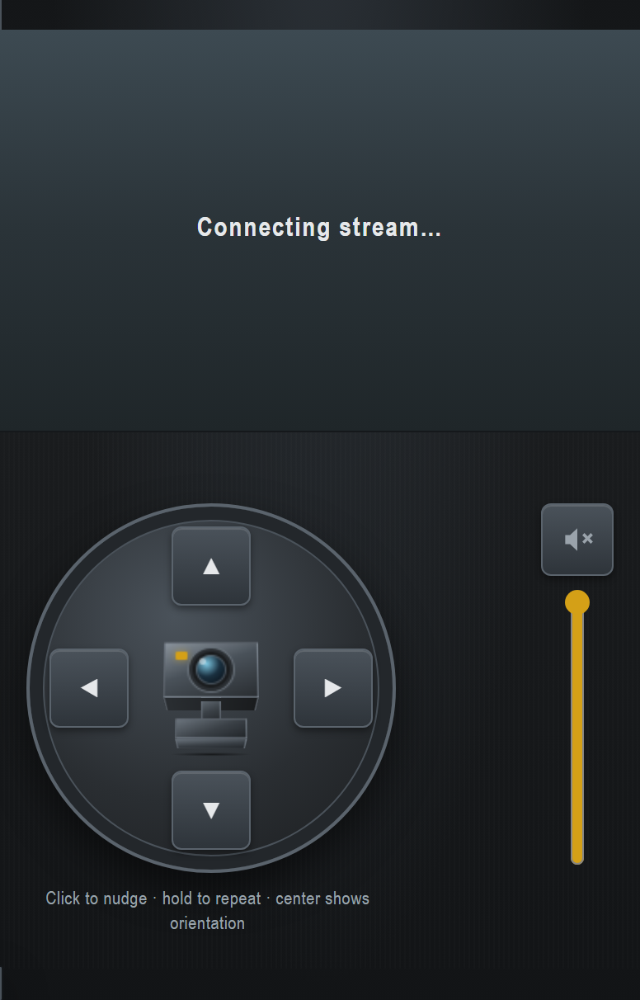

# Tapo C260 Camera Card

Home Assistant Lovelace card (`custom:tapo-c260-card`) for a **Tapo C260**: live stream viewport, compact circular PTZ pad, and a Concept C industrial 3D orientation graphic.



**Required companion:** HACS [Tapo: Cameras Control](https://github.com/JurajNyiri/HomeAssistant-Tapo-Control) (`tapo_control`). This card does **not** replace that integration — it presses the move / calibrate buttons and reads movement angle / privacy entities that `tapo_control` exposes.

## Features

- Portrait, stream-dominant layout with circular pad below the feed
- Sections layout defaults to **full width** and **height: auto** (fit content)
- Click-to-nudge **and** press-and-hold repeat on pan/tilt
- Center of the pad is a **display-only** 3D orientation graphic (not a button)
- Yaw / pitch readout **on press only**, and only once orientation is known (hidden when unknown)
- Stream **pinch-to-zoom** and one-finger **pan** when zoomed (local viewport crop; never drives PTZ; resets on reconnect)
- Downlink **mute toggle + volume slider** (default muted for autoplay; no native video controls)
- Live camera stream: **WebRTC → multi-`<source>` MP4 (hls.js for HLS on Chrome) → MJPEG** (snapshot last)
- Prefers **HD when `camera_hd` is set** (primary entity + earlier HTTP candidates); SD is a fallback only — **no runtime SD↔HD switching**
- Phone-first touch targets (≥44px)
- Single camera
- Lovelace visual editor: pick the **Tapo device** and entities auto-fill; optional **go2rtc** lives under **Advanced**
- Local Vite demo with mock `hass` (no HA install)

There is **no** card `title` config — the stream area has no title chrome.

## Lovelace config

### Visual editor

After the card resource is loaded, use the dashboard UI:

1. Edit a dashboard → **Add card** → search **Tapo C260 Camera Card**.
2. Select your **Tapo camera device** (from `tapo_control`) — camera SD/HD, PTZ buttons, angle, calibrate, preset, and privacy fill in automatically.
3. Optionally set hold interval. Open **Advanced** for optional **go2rtc**, or **Entity overrides** only if a mapping needs a tweak.
4. Save.

### YAML

```yaml
type: custom:tapo-c260-card
# Preferred: set device and let the card/editor resolve entities
# device: <tapo_control device id>
camera: camera.living_room_sd
camera_hd: camera.living_room_hd
# Optional go2rtc — editor: Advanced → go2rtc stream (optional)
# go2rtc: living_room
# go2rtc: ws://192.168.1.10:1984/api/ws?src=living_room
ptz:
  up: button.living_room_move_up
  down: button.living_room_move_down
  left: button.living_room_move_left
  right: button.living_room_move_right
  angle: number.living_room_movement_angle
  calibrate: button.living_room_calibrate
  # preset: select.living_room_move_to_preset
privacy: switch.living_room_privacy
```

Entity IDs are instance-specific — the visual editor fills them from the device. Manual YAML can still paste IDs from the `tapo_control` device page.

### Stream behavior

Playback is **not** a single `.m3u8` stuck on `<video src>` (that fails on Chrome with “No decoders for … mpegurl”). Order:

| Step | Path |
| --- | --- |
| 1 | **WebRTC** via go2rtc WebSocket and/or HA `camera/webrtc/*` — prefers `camera_hd` when set, then `camera` |
| 2 | One `<video>` with Lit-rendered **`<source>`** children that the browser can actually decode: go2rtc `stream.mp4` (and native HLS **only on Safari**). Chromium never gets `type="application/vnd.apple.mpegurl"` sources — that breaks `video.load()` |
| 3 | **hls.js** for HLS playlist URLs on MSE browsers (Chrome/desktop) |
| 4 | **MJPEG** `/api/camera_proxy_stream/…`, then still/poster |

When both `camera` and `camera_hd` are set, the card **prefers HD** as the primary WebRTC entity and lists HD HTTP candidates before SD. Browsers pick the first *compatible* `<source>`, not “highest quality” by themselves — quality preference comes from our candidate order and primary-entity choice, not from runtime switching. PTZ no longer tears down / swaps streams.

Pinch / pan only crops the received pixels locally. Stream reconnect or player restart resets zoom to 1×.

### go2rtc URL expectations

Optional `go2rtc` is configured in the editor under **Advanced**, or as a YAML string:

| Value | Meaning |
| --- | --- |
| Stream name (`living_room`) | Resolved against HA as `/api/webrtc/ws?src=…` (AlexxIT WebRTC) and `/api/ws?src=…` |
| `ws(s)://host:1984/api/ws?src=name` | Direct go2rtc WebSocket (preferred for LAN go2rtc) |
| `http(s)://host:1984/api/ws?src=name` | Same; converted to `ws(s)` for signaling; HTTP `…/api/stream.mp4` and `…/api/stream.m3u8` are added as `<source>` candidates |
| Omitted | HA camera entity WebRTC / HLS only |

Device autofill does **not** invent a go2rtc stream name — set it yourself if you use go2rtc. Ensure go2rtc already exposes that `src` name.

### Optional keys

| Key | Purpose |
| --- | --- |
| `device` | `tapo_control` device id — auto-associates entities |
| `camera_hd` | Preferred HD camera entity (SD/`camera` stays a fallback source; no PTZ switch) |
| `go2rtc` | Stream name or absolute go2rtc `/api/ws` URL (editor: **Advanced**) |
| `hold_interval_ms` | Hold-to-repeat interval (default `350`) |
| `privacy` | Privacy switch — disables the pad when `on` |
| `ptz.calibrate` | Calibrate / home button entity (service call; not the pad center) |
| `ptz.preset` | Optional preset select entity |

## Dependencies

1. Home Assistant with [HACS](https://hacs.xyz/)
2. **[Tapo: Cameras Control](https://github.com/JurajNyiri/HomeAssistant-Tapo-Control)** installed and a C260 added
3. Recommended for live video: [go2rtc](https://github.com/AlexxIT/go2rtc) (HA built-in go2rtc integration and/or [WebRTC Camera](https://github.com/AlexxIT/WebRTC))

Do **not** run the official `tplink` integration and `tapo_control` on the same camera.

PTZ uses current `tapo_control` surfaces only: `button.press` on move / calibrate entities, optional `number.*_movement_angle`, optional `switch.*_privacy`. Legacy `tapo_control.ptz` is not used.

## Install

This is a Lovelace **frontend** card (Lit bundle + `hacs.json`). Install via HACS as a custom repository when a release asset is available, or copy the built module manually.

### Option A — HACS (custom repository)

1. Install [HACS](https://hacs.xyz/) if you do not already have it.
2. Open **HACS → Frontend** (three-dot menu) → **Custom repositories**.
3. Add this repository:
   - **Repository:** `https://github.com/CommanderQ/home-assistant-tapo-camera-dashboard`
   - **Category:** **Lovelace**
4. Find **Tapo C260 Camera Card** in HACS → Frontend → download / install it.
5. When prompted, reload the frontend (or restart Home Assistant).
6. Confirm a dashboard resource exists (**Settings → Dashboards → Resources**):
   - URL similar to `/hacsfiles/home-assistant-tapo-camera-dashboard/tapo-c260-card.js`
   - Type: **JavaScript Module**  
   HACS usually adds this for you; add it manually only if it is missing.
7. Add the card from the dashboard UI ([visual editor](#visual-editor)) or paste the YAML from [Lovelace config](#lovelace-config).

`hacs.json` names the frontend file as `tapo-c260-card.js`. HACS serves that file from a **GitHub Release** asset with the same filename. If no release is published yet, use Option B (manual) after building locally, or wait for a release that includes `tapo-c260-card.js`.

### Option B — Manual resource

Use this when developing from source or when no HACS release asset exists yet.

1. Clone the repo and build the card:

   ```bash
   git clone https://github.com/CommanderQ/home-assistant-tapo-camera-dashboard.git
   cd home-assistant-tapo-camera-dashboard
   npm ci
   npm run build
   ```

2. Copy the bundle into Home Assistant’s www folder (create `www` if needed):

   ```bash
   # Example paths — adjust for your HA config directory
   cp dist/tapo-c260-card.js /config/www/tapo-c260-card.js
   ```

3. **Settings → Dashboards → Resources → Add resource**
   - **URL:** `/local/tapo-c260-card.js`
   - **Resource type:** JavaScript Module
4. Reload the browser (hard refresh) and add the card YAML from [Lovelace config](#lovelace-config).

Updating later: rebuild, replace `config/www/tapo-c260-card.js`, then hard-refresh the dashboard.

## Releases

GitHub Release (HACS asset `tapo-c260-card.js`) is published **only when** `package.json` `version` changes on `main` versus the previous commit, and tag `vX.Y.Z` does not already exist.

- Docs, UI, and other commits that leave the version unchanged do **not** cut a release
- There is **no** automatic patch bump
- To ship: bump `version` in `package.json` (keep the lockfile in sync) → push `main` → Actions builds and attaches `tapo-c260-card.js`

## Local demo (no Home Assistant)

```bash
npm ci
npm run demo
```

Open the URL Vite prints (default [http://127.0.0.1:5173](http://127.0.0.1:5173)).

- Mock `hass` logs `button.press` / privacy toggles in the on-page service log
- Stream shows a connecting placeholder until a real go2rtc / camera proxy URL is configured
- Mute / volume chrome and the display-only center graphic match the Lovelace card
- Use **Toggle privacy** to verify pad lockout

### Other scripts

| Command | What it does |
| --- | --- |
| `npm run demo` | Vite dev server for `demo/` |
| `npm run build` | Production ES module → `dist/tapo-c260-card.js` |
| `npm run typecheck` | `tsc --noEmit` |
| `npm run preview` | Preview a production demo build |

## Orientation model

Tapo / `tapo_control` expose **relative** moves, not an absolute pan/tilt sensor. The center graphic **dead-reckons** from commanded nudges (using Movement Angle when available) and is **display-only**. The optional `ptz.calibrate` entity still runs calibrate / home via `button.press` when configured; it is not wired to a tap on the pad center. Treat the readout as approximate until a later ONVIF/`GetStatus` path is proven.

## License

[MIT](./LICENSE)
